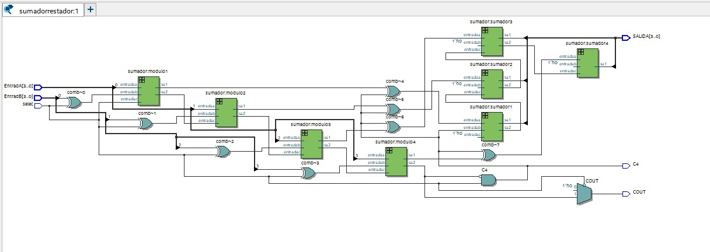

        
# Lab01 - Sumador/Restador de 4 bits

# Integrantes
* [Julian Ricardo Ortiz Lozano](<!-- Remplace aqui link de usario 1 de github -->) 
* [Fernando Alexander Martinez](<!-- Remplace aqui link de usario 2 de github -->) 
* [Leidy Viviana Galeano Castillo](<!-- Remplace aqui link de usario 3 de github -->) 
# Informe

Indice:

    
SUMADOR DE 1 BIT 

por medio de codigo se implemento una compuerta nand de manera primitiva para futuras instantancias de codigos

SUMADOR DE 4 BITS

Para este sumador se instancia 4 veces el sumador de 1 bit

RESTADOR SUMADOR DE 4 BITS 

Duplicamos el sumador de 4 bits y mientras el selector estuviera activo se consideraba un sumador y cuando estaba abajo un restador 

SUMADOR RESTADOR 

Es la implementacion de todos los codigos con un selector que nos permite alternar entre sumar y restar

3. [Evidencias de implementación]

FOTO DEL SUMADORESTADOR IMPLEMENTADO EN LA FPGA

(#evidencias-de-implementación)
4. [Preguntas](#preguntas)
5. [Conclusiones](#conclusiones)
6. [Referencias](#referencias)

#### 1.2 Diagramas

Diagrama de sumador restador y de las instancias realizados 

## Simulaciones 

Para corroborar y mostar a manera el manejo de señales y que su resultado con la practica sea el esperado.

sumador

sumador restador 

## Conclusiones

De este proyecto pudimos concluir y desarrollar nuevas habilidades a cerca del manejo de conceptos basicos y operaciones con numero binarios a traves de el desarollo de los ejercicios y implimentaciones presentadas.

## Referencias

- digitalECCI. (2026). *arquitecturaDeProcesadoresG1E6: Arquitectura de Procesadores - Grupo 1 Equipo 6*. GitHub. [https://github.com/digitalECCI/arquitecturaDeProcesadoresG1E6](https://github.com/digitalECCI/arquitecturaDeProcesadoresG1E6)